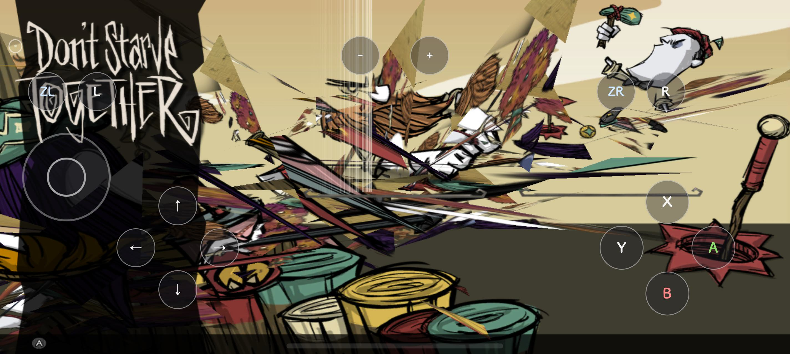
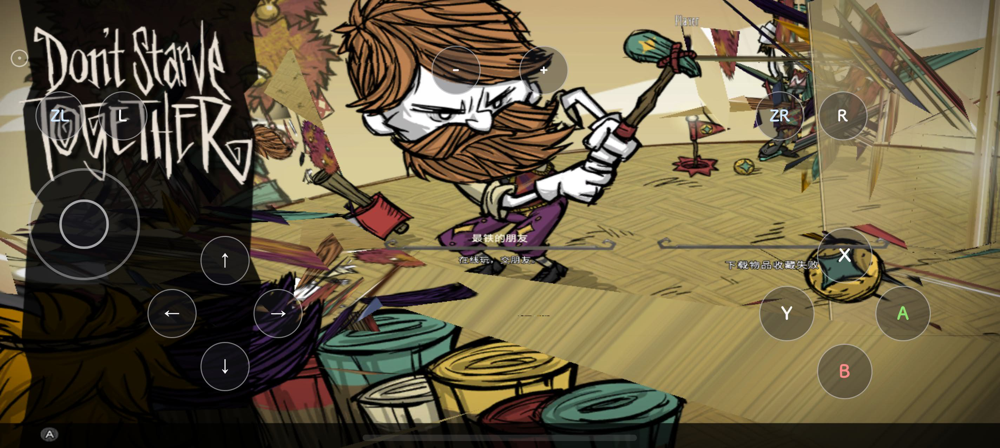
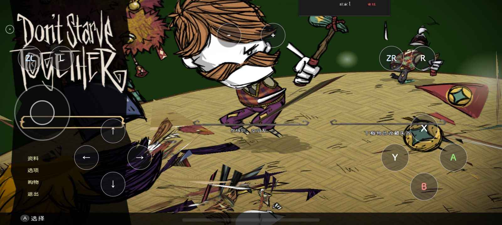
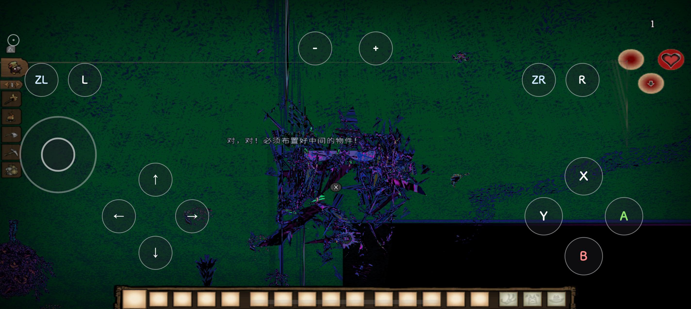

# 饥荒联机版（Switch）跑在鸿蒙真机上 · HLE 原生移植

**Don't Starve Together** 的 Nintendo Switch 版本，在华为鸿蒙手机上**原生执行**：不是模拟器套壳、不是重制、不是云游戏。客体的 ARM64 机器码直接跑在我们的 HLE（High-Level Emulation）宿主里，它调用的每一件系统能力——线程与信号量、文件系统、socket、手柄、音频、以及 **NVN 图形 API**——都由鸿蒙的原生实现顶上，NVN 被逐调用**重放进 Vulkan**，画在 Maleoon 920 上。

**当前状态（2026-10-23）**：**已经跑进真世界，地面纯绿这条已结案**。EULA → 主菜单 → 创世界设置 → 选角色 → **在世界里**：第 1 天 HUD、物品栏图标、光照、中文文字（字幕与菜单）都正常。剩下的是几何不是格式：**多部件实体还在撕裂**——标题画的人物、选角头像面板、世界里的建筑会掉出杂散三角与错位条纹。同一屏本周前后对比：

<p align="center">
  
  
</p>
<p align="center"><sub>左：本轮修复前（AK1 构建）的标题画面。右：当前构建（AN）的同一屏——人物、锤子、旗帜成形了，右缘的碎片就是还没收掉的账。同一台机、同一条打包链，没有针对某一屏的特例。</sub></p>
<p align="center">
  
  
</p>
<p align="center"><sub>左：主菜单已完整渲染。右：确实在世界里（第 1 天、物品栏、三颗属性球、一句中文字幕都在），中间那座建筑就是上面的撕裂。</sub></p>

平台：Huawei 真机（HarmonyOS NEXT，Maleoon 920，2848×1276）· 客体版本：Switch 版饥荒联机版 · 许可：MIT · **游戏文件自带（BYOG），本仓库不含任何游戏内容**

English: [README.md](README.md) · 详细进度：[docs/STATUS.md](docs/STATUS.md) · 卡点：[docs/BLOCKERS.md](docs/BLOCKERS.md) · 解包：[docs/UNPACKING.md](docs/UNPACKING.md)

> `docs/` 下的技术文档目前只有英文版（STATUS / BLOCKERS / UNPACKING / BUILD-OHOS / DM-SWITCHES / CONTENTS）；`DEPENDENCIES` 有中英双语。

---

## 为什么是这条路

Switch 上的游戏要在别的平台跑，通常只有两条路：写一个完整的 Horizon OS 模拟器（要 CPU JIT、要全套服务、要着色器编译器），或者——如果这款游戏**只用了很少的平台服务**——把它当成一个"目标 ABI 换掉的动态库"，用 HLE 直接把系统调用和 API 一一实现出来。饥荒属于后者：它的图形走 NVN（可以机械地映射到 Vulkan），它的平台需求集中在少量 `nn::*` 服务上，而它的数据（romfs）可以原样读。

同一套宿主此前已经跑通了《暗黑破坏神 II：重制版》的 Switch 版（见 [d2r-mobile](https://github.com/jhaizhou-ops/d2r-mobile)，同一作者，MIT）。本仓库是它的**鸿蒙分支**：宿主层复用，新写的是 HarmonyOS 端口（NAPI/XComponent/OHAudio/触控）与 **NVN→Vulkan 重放层**（`dm/gfx/nvn/nvn_vulkan.c`）。

## 一图看懂数据怎么流

```
hdc aa start --ps DM_xxx  ──►  ArkTS 入口（EntryAbility）把参数交给 NAPI
                                 ─► libdmhost.so：装载 main / sdk / subsdk0（ELF + 指令级补丁表）
                                     ├─ SVC 层     hle_svc.c      含 pre-4.0 语义量族 0x1A–0x1D
                                     ├─ 线程层     hle_thread.c   条件变量 / 伪唤醒兜底
                                     ├─ 文件系统   hle_fs.c       romfs 挂载 + 三级路径兜底 + 全量 basename 索引
                                     ├─ 网络       hle_net.c      真 BSD socket（游戏自己的本机 shard 要它）
                                     ├─ 输入       hle_hid.c      屏幕手柄 / 触控 → Npad
                                     ├─ 音频       hle_audio.c + ohos/audio_ohos.c（OHAudio）
                                     └─ 图形       gfx/nvn/nvn_vulkan.c   NVN 调用逐条重放进 Vulkan
                                          └─ 内存池 → 打包队列 → BC/ASTC 软解 → staging → vkUploadTexture
```

一个有用的性质：**客体模块内的文件偏移与内存偏移 1:1**。所以任何崩溃地址 `pc=<模块>+<偏移>` 都能离线反查——直接查 ELF 的 `.dynamic`/`.dynsym`/`.rela.plt`，不需要在设备上装调试器。这条性质让"真机跑一轮 → 离线定位到具体符号"变成一个 5 分钟的动作。

## 已经拿下的（挑有代表性的）

完整的带判据清单在 [docs/BLOCKERS.md](docs/BLOCKERS.md) 与 [docs/STATUS.md](docs/STATUS.md)；这里只说几条能省别人几小时的：

- **启动链全通**：`nnosInitialize` → SDK 模块初始化 → 三模块全局构造（301+112+45 项）→ `nnMain` → romfs 挂载 → 12+ 个客体线程 → 音频打开。
- **一批服务缺口**：eShop、Joy-Con 分离态一族、默认音频输出重载、`nn::oe::SetCpuBoostMode`、`nn::pctl::IsFreeCommunicationAvailable`。共同机制是客体的 `sm::Initialize()` 连不上服务 → SDK 读到无效响应 → `diag::AbortImpl` 自杀。**剪口只加在本项目主程序不引用的符号上**，零基线风险。
- **NVN→Vulkan 重放层**：补齐 18 个客体要但宿主没有的入口；视口 Y 翻（含裁剪盒）修上下镜像；**UI 平涂的真因是 NVN→Vk 混合因子表错位**；着色器库从 96 键推到 222 键，`无库` 占比 41% → 10%，键方案重做后一次换包不再作废。当前装机库 115 条 / 1.2 MB，里面**含字体顶点段**（第 114 条）——找法是"点名一个键、只回放在用它的绘制"（`DM_SPKEY`/`DM_SPFROM`/`DM_SPN`/`DM_SPDEC`），同一条路证明了"文字没了"缺的是着色器而不是素材。
- **状态保真（本周）**：重放层把以前丢掉的几样捡回来了——顶点重绑**把属性数改小**这一支、属性数本身进管线键、动态状态只要客体改过就重发（不再只在换管线时发，并把模板三样声明成动态）、深度模板清屏真正读 `depth_mask`/`stencil`/`stencil_mask`（且只在格式真有模板面时才清模板）。
- **贴图上传链**：巨图另开暂存（不再挤 64 MB arena）、脏页重传、缺页钩子在 OHOS 上从零接起来（`OC_ES_ESR` 在非 Apple 平台恒 0，所以"写"这件事必须自己判定），以及**设备端 BC→ASTC 现编**——没有 BC 支持的 GPU 也能拿到地形。
- **socket 层从"一律返回 ENETDOWN"改成真 BSD**：饥荒的单机模式会在自己进程里起两个 shard（Server Master / Secondary），用 RakNet 连 `127.0.0.1`。没有真 socket 就永远卡在"启动服务器"。
- **素材路径解析**：三层兜底 + 惰性全量 basename 索引，**离线穷举 21,310 个文件全量重筛**，真机判据是"未解析清单文件根本没被创建过"。
- **取证通道**：像素走文件不走日志（hilog 会静默吞长行和突发行）、崩溃现场落文件、线程转储、采样行带上"最近一次 SVC 号"（一眼分辨"在等"和"在 SVC 里空转"）。
- **不用截图的场景指纹**：每帧绘制数在不同界面足够稳定——2=启动、12–14=开场与标题、40–44=子菜单、106–164=创世界设置弹窗、651=选人册、750 以上=真在世界里。自动化每轮靠这个数字判断"这一下点没点动"，而不是靠像素比对；它就是抓出"点了 34 次 A 以为在推进、其实游戏一直在 142↔149 之间开关同一个面板"的那次。

## 卡在哪

**多部件实体还在撕裂**（唯一功能卡点）。标题画的人物、选角头像面板、世界里的建筑都会画出来，但掉出杂散三角形和行距错位的条纹；还有一个弹窗标题在、整条按钮文字是空的。这一条现在落在层已经定位，不是猜：本周落地的顶点缩绑闸、属性数进管线键、动态状态脏标记重发，计数说明它们走在热路径上而不是冷分支——当前构建在标题画面读回 `缩绑:属77035 流0 动发228180`（77,035 次"把属性数改小"的重绑；228,180 次动态状态重发）、`清屏:模板13700 无面0 全跳0`（13,700 次以前根本不会发生的模板清除，且没有一次落在没模板面的格式上）。同一行里 `色掩或15与15` 说明客体的 color mask 实际上是个布尔量，所以那半边只记账不改行为。细节、判据、下一步都在 **[docs/BLOCKERS.md](docs/BLOCKERS.md)**。

本周结案、也是最大的一条：**地面贴图纯绿**。Maleoon 920 几乎不收 BC 系列格式，被绑定 266,425 次的地形图集原本没有任何上卡路径。现在宿主自己把 BC1/BC3/BC4/BC5 现编成 ASTC 4×4：设备端在上传那一刻用交叉编出来的 astcenc 5.7.0 转，带一份落盘缓存（第二次启动读盘不重编），同一套转换也有 PC 离线全量烘的版本。`ASTC缓存 命中/新写/盘错/额尽` 告诉你这一轮走的是哪条。

另外四条已知的账：丢唤醒的**根因**还没修（现在靠伪唤醒兜底）、渲染通道不看客体点名的附件级/层（一律 0 级 0 层，要补一份按子资源的 `VkImageView` 缓存）、性能（世界内 `hidumper` 记到 23.7–30.0 fps 提交、p99 250 ms、世界生成 2m20s 而原版 20–40s；注意这个数是**提交**帧率，还不算一次干净的实机游玩帧率）、真输入框与触控 finger 上报。

## 你要自己跑一遍

1. **[docs/UNPACKING.md](docs/UNPACKING.md)** —— 用**你自己合法获得**的游戏介质与**你自己设备导出的**密钥，取出三个模块与 romfs，跑指令级补丁，打成两层 romfs 目录。本仓库不带这些产物。
2. **[docs/BUILD-OHOS.md](docs/BUILD-OHOS.md)** —— 交叉编出 `libdmhost.so`，塞进 HAP 工程，签名装机。
3. **[docs/DM-SWITCHES.md](docs/DM-SWITCHES.md)** —— 启动参数（诊断开关全在这里，不用读代码）。
4. **[docs/CONTENTS.md](docs/CONTENTS.md)** —— 这个仓库里**有什么、没有什么**，以及每一条为什么必须在。

## 免责与许可

本仓库只包含我们自己写的与第三方开源的**代码和文档**：**不含**游戏程序、美术、音频、文本、数据表、着色器二进制，也不含任何密钥。所有游戏内容都要由使用者从**自己拥有的**游戏副本里生成。饥荒联机版是 Klei Entertainment 的作品，Nintendo Switch 是任天堂的商标；本项目与两者均无关联，也不为它们背书。请勿用它做任何侵犯版权的事。

代码以 MIT 许可发布（见 [LICENSE](LICENSE)）；来源与第三方声明见 [NOTICE](NOTICE)。
